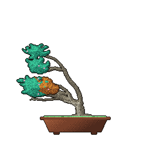
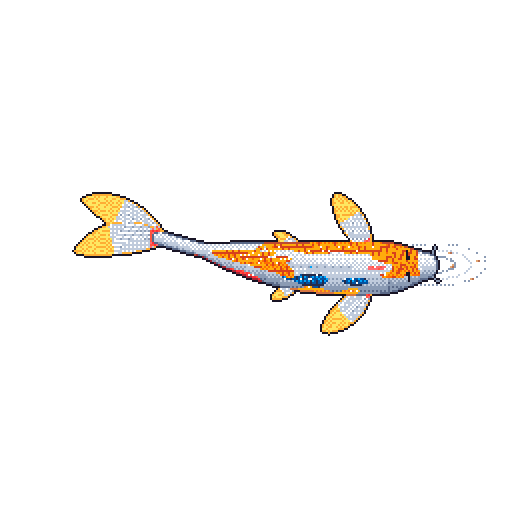

### Hello there!! 👋

I am a passionate Data Science and AI enthusiast who finds joy in exploring new ideas and discovering innovative solutions. With a curious mind and a desire to learn, I constantly seek out-of-the-📦 approaches to challenges. 

🔭 I’m actively engaged in developing an image-to-image translation model specifically for medical images. This project involves using advanced technology to enhance the accuracy and precision of image translations, which can have a significant impact on improving medical diagnoses and treatments.

🌱 I’m currently expanding my knowledge on large language models, with a particular focus on the Persian language. The field of language models is constantly evolving and improving, and I am excited to stay up-to-date with the latest advancements in this area.

### ⚡ Areas of Expertise:
- Deep Learning
- Data Science
- Machine Learning
- Computer Vision

---

  
  &nbsp;&nbsp;
  
  &nbsp;&nbsp;
  
   
  All three are drawn from my public GitHub activity and redrawn every day. Bonsai by <a href="https://github.com/egorthinks/git-bonsai">git-bonsai</a> · Carpet by <a href="https://github.com/AlirezaAzadbakht/git-carpet">git-carpet</a> · Koi by <a href="https://github.com/yalongwastaken/git-koi">git-koi</a>

<!--
**AlirezaAzadbakht/AlirezaAzadbakht** is a ✨ _special_ ✨ repository because its `README.md` (this file) appears on your GitHub profile.
